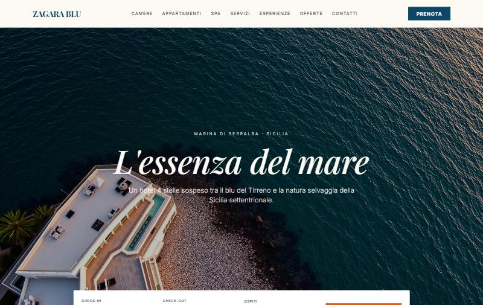

# Zagara Blu Hotel & Spa — demo website



A multi-page website for **Zagara Blu Hotel & Spa**, a _fictional_ four-star seaside hotel in the
imaginary village of Marina di Serralba, Sicily. I built it as a concept proposal for a boutique
hotel: the goal was a fast, elegant site that presents rooms, apartments, spa and local
experiences, and turns visitors into booking requests.

> **Note:** this is a portfolio/demo project. The hotel, its address, phone number, email and
> guest reviews are invented. All photos are AI-generated. Forms do not send or store any data.

## Features

- **11 pages** in Italian: home, rooms, apartments, spa, services, experiences, offers,
  contacts and legal pages (privacy, cookies, terms).
- **Server-side rendering** with TanStack Start, so every page ships real HTML with its own
  `<title>`, description and Open Graph tags for search engines and link previews.
- **Booking widget → contact form flow**: the availability widget validates dates and passes them
  to the contact page through typed URL search params; the message is pre-filled (e.g. _"from
  01/07 to 08/07 (7 nights) for 2 adults"_). Untrusted query values are validated before use.
- **Responsive design** from 375 px phones to wide desktops, with a full-screen mobile menu.
- **Dynamic `sitemap.xml`** served by a server route, plus `robots.txt`.
- **Graceful error handling**: custom 404 page, React error boundary and a fallback HTML page
  if server rendering fails.
- **Accessible markup**: semantic landmarks, labelled form fields and image `alt` text.

## Tech stack

| Area      | Tools                                                        |
| --------- | ------------------------------------------------------------ |
| Framework | [TanStack Start](https://tanstack.com/start) (React 19, SSR) |
| Routing   | TanStack Router — file-based, type-safe routes               |
| Styling   | Tailwind CSS v4, shadcn/ui (Radix primitives), Lucide icons  |
| Build     | Vite 8, Nitro (server bundle)                                |
| Quality   | TypeScript (strict), ESLint, Prettier, Vitest                |
| CI        | GitHub Actions: lint → typecheck → tests → build             |

## Getting started

Requirements: [Node.js](https://nodejs.org/) 22 or newer.

```bash
git clone https://github.com/Zeus-coding/zagara-blu-hotel.git
cd zagara-blu-hotel
npm install
npm run dev
```

Then open <http://localhost:8080>.

## Scripts

| Command             | What it does                                 |
| ------------------- | -------------------------------------------- |
| `npm run dev`       | Start the development server with hot reload |
| `npm run build`     | Production build (output in `.output/`)      |
| `npm run preview`   | Serve the production build locally           |
| `npm run lint`      | Run ESLint (with Prettier formatting rules)  |
| `npm run typecheck` | Type-check the project with `tsc`            |
| `npm test`          | Run the unit tests with Vitest               |
| `npm run format`    | Format all files with Prettier               |

## Project structure

```text
src/
├── routes/          # One file per page (file-based routing) + sitemap.xml server route
│   └── __root.tsx   # HTML shell, global SEO tags, header/footer, 404 and error pages
├── components/      # Header, footer, hero, gallery, booking widget
│   └── ui/          # shadcn/ui building blocks
├── lib/             # Booking helpers (+ tests), error handling, utilities
├── assets/          # AI-generated images
├── server.ts        # SSR entry with a friendly fallback error page
└── styles.css       # Tailwind theme: sea blue, sand and terracotta palette
```

## Deployment

`npm run build` produces a standalone server in `.output/`. Nitro detects the hosting platform
automatically, so the project can be deployed to Vercel, Netlify or any Node.js host without
extra configuration.

## License

Code released under the MIT License. Images are AI-generated and included for demonstration only.
